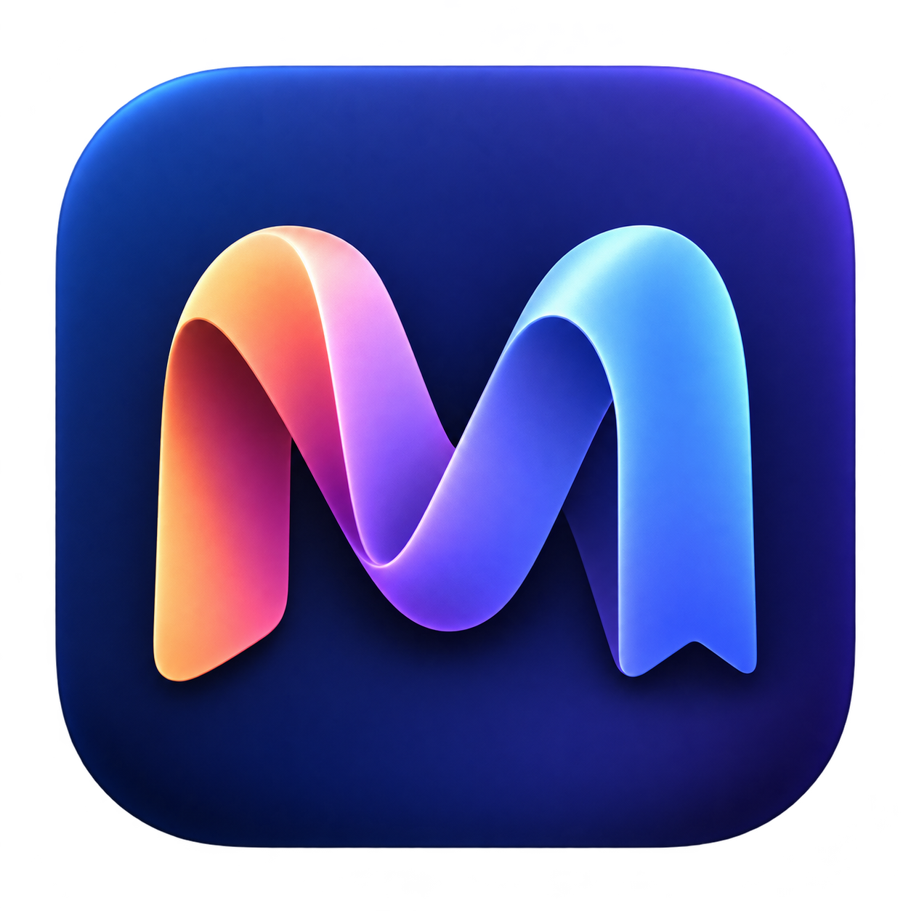

<p align="center"></p>

<h1 align="center">Memora</h1>
<p align="center"><strong>Grave uma conversa. Volte ao que importa.</strong><br>Captura de áudio e transcrição local na barra de menus do macOS.</p>

Memora reúne gravação de microfone e áudio do computador, histórico por data e leitura de transcrições com timestamps. O processamento de fala acontece no próprio Mac, com WhisperX e Nemotron-3.

> **Em desenvolvimento.** Este repositório contém o código-fonte, não um instalador pronto. O aplicativo ainda depende da preparação manual dos runtimes e modelos locais. A qualidade das transcrições e da separação de falantes varia: revise o texto antes de usá-lo como registro definitivo.

## O que você pode fazer

- **Gravar quando decidir:** inicie e pare pela barra de menus ou por um atalho configurável.
- **Capturar duas fontes:** microfone e áudio do computador são armazenados separadamente.
- **Encontrar conversas:** navegue pelo histórico com calendário, renomeie sessões e organize com tags e filtros.
- **Marcar momentos:** adicione marcadores durante a gravação e navegue até eles no leitor.
- **Revisar falantes:** confirme seu nome manualmente e corrija atribuições por trecho, com opção de desfazer.
- **Revisitar trechos:** leia a transcrição com horários e ouça o áudio correspondente.
- **Transcrever localmente:** use WhisperX large-v3 para reconhecimento e alinhamento, e Nemotron-3 para diarização.
- **Controlar o armazenamento:** revise os arquivos elegíveis antes de apagar áudios ou transcrições.
- **Consultar por MCP:** integração local opcional, somente leitura, para listar e pesquisar sessões.

## Privacidade e controle

As gravações, transcrições, preferências, modelos e caches ficam em `.local/`, fora do versionamento. O worker de transcrição usa modelos locais e bloqueia conexões de rede; não há envio de áudio para uma API de transcrição.

O monitor de níveis pode acessar as fontes selecionadas mesmo fora de uma gravação. Nesse estado, mede o sinal em memória, sem criar arquivos de áudio. Desative as fontes nas configurações para interromper esse acesso.

Antes de gravar, obtenha as permissões e o consentimento necessários. Os arquivos locais não têm criptografia própria do aplicativo: proteja a conta, o disco e os backups do Mac. Se conectar o MCP a outro aplicativo, as informações que esse aplicativo consultar poderão ser tratadas conforme as configurações dele.

## Requisitos

- macOS 26 ou posterior para o fluxo de captura de áudio do computador adotado pelo projeto.
- Node.js 22 ou posterior e as Command Line Tools da Apple.
- Runtime Electron para macOS disponível localmente.
- Para transcrição: ambiente Python com WhisperX e dependências compatíveis, modelos de reconhecimento/alinhamento já obtidos e runtime Nemotron-3 com o modelo Q8_0 esperado pelo código. O fluxo atual de diarização usa Metal em Apple Silicon.
- Permissões de microfone e captura de áudio do sistema, concedidas pelo usuário quando solicitadas pelo macOS.

Os modelos e runtimes não são distribuídos neste repositório. Consulte as licenças e requisitos de cada componente antes de obtê-los. A configuração de transcrição ainda é específica do layout esperado em `src/experimental.cjs`; não há instalador automático para esse fluxo. Sem os modelos, o app informa indisponibilidade da transcrição e preserva o áudio.

## Executar o código

Depois de obter o código e preparar os requisitos, entre na pasta do projeto. Indique o executável de um Electron existente ou disponibilize-o em `node_modules/electron/dist/Electron.app`:

```sh
export SONORA_ELECTRON="/caminho/para/Electron.app/Contents/MacOS/Electron"
npm start
```

`npm start` prepara o pacote local quando necessário e abre o aplicativo com identidade própria. A primeira execução pode pedir permissões do macOS. Os scripts não concedem essas permissões automaticamente.

```sh
npm run build:app    # gera o pacote local vinculado ao checkout
npm run check        # valida a sintaxe de JavaScript
npm test             # executa os testes Node
```

O pacote gerado depende deste checkout: ainda não é uma distribuição independente. `npm install` sozinho não prepara o Electron nem os modelos de transcrição.

Para diagnósticos adicionais, `npm run smoke` e `npm run smoke:recording` usam um perfil isolado. O teste `npm run test:native` pode acessar áudio real; execute-o apenas quando quiser testar a captura e tiver as permissões necessárias.

## Como o projeto está organizado

| Pasta | Responsabilidade |
| --- | --- |
| `src/` | Interface Electron, gravações, histórico, transcrição e MCP |
| `native/` | Helper Swift para captura de áudio do macOS |
| `scripts/` | Inicialização, build e diagnósticos |
| `test/` | Testes automatizados e fixtures sintéticas |
| `assets/` | Identidade visual |
| `licenses/` | Avisos e licenças de componentes de terceiros |

O nome interno `sonora` e as variáveis `SONORA_*` são mantidos por compatibilidade. O nome do aplicativo é **Memora**.

## Estado desta versão

Baseado no build `2026-11-11-organization-speaker-review`. A validação da versão de desenvolvimento registrou 159 testes Node, 24 testes Python, interface e gravação sintética, além de transcrição e diarização de duas fontes sintéticas. Isso não equivale a uma avaliação de precisão em reuniões reais nem a uma instalação limpa em outro Mac.

## Limites conhecidos

- A preparação de ambientes Python, Electron e modelos ainda não está automatizada nem validada como instalação limpa em outros Macs.
- Transcrição pode errar palavras, omitir falas ou gerar texto incorreto. A diarização não comprova identidade; nomes precisam ser revisados.
- O idioma automático do fluxo atual resolve para português. Outros idiomas dependem dos modelos locais correspondentes.
- Captura, permissões e mudanças de dispositivos dependem do macOS e precisam de validação no equipamento usado.
- Excluir arquivos pela limpeza do aplicativo é uma ação permanente. Revise a seleção e mantenha backups quando necessário.

## Licenças

Electron, WhisperX, Nemotron-3 e demais componentes mantêm seus próprios termos. Este repositório não distribui os respectivos runtimes ou pesos.

**Documentação de licença pendente de conferência:** o arquivo preservado `licenses/Nemotron-3-OpenMDW-1.1.txt` contém texto Apache 2.0, apesar de seu nome. Não o trate como confirmação da licença dos pesos ou de todos os componentes. Consulte os termos na origem de cada dependência antes de obtê-la ou redistribuí-la.

O código do Memora é publicado sob a [licença MIT](LICENSE). Essa licença não substitui os termos próprios dos modelos, runtimes e demais componentes de terceiros.
